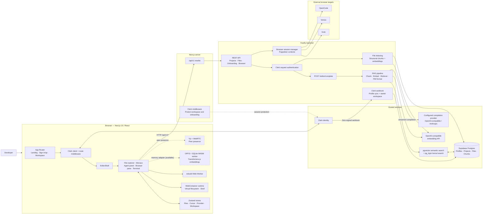
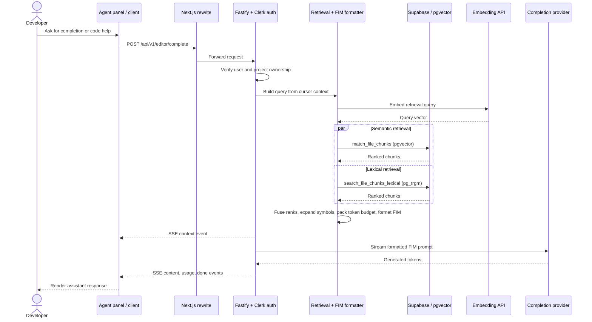

# ACE AI IDE Architecture

## Main AI completion path

## Data and feature boundaries

- The workspace UI keeps its active file tree in a Zustand store. The terminal
  mounts those files into the browser WebContainer before running commands.
  The current workspace file tree is not automatically persisted to the
  backend's Supabase file tables.
- The Fastify file API stores project files in Supabase and indexes saved files
  as structural chunks with embeddings. Retrieval combines semantic and
  lexical search; symbol expansion is optional input to the retrieval layer.
- The Agent panel calls the completion endpoint, but currently sends a
  placeholder project ID; the backend checks project ownership, so this needs
  a real project ID before agent requests can succeed. The Monaco editor
  provides editing and cursor tracking; the API driver and inline-completion
  wiring are not currently enabled.
- The browser pane uses backend-managed Puppeteer sessions for Grok, Venice,
  or OpenCode. Its session endpoints allow guest sessions; this is separate
  from the WebContainer used for local code execution.
- Local OPFS memory, Yjs/WebRTC collaboration, and WebContainer execution are
  present as client-side adapters/features. Local memory is not part of the
  backend RAG pipeline.
- The Chrome extension driver, direct BYOK API driver, TypeScript agent loop,
  client audit, and static-export cutover are planned feature-flag stages, not
  active architecture paths.
