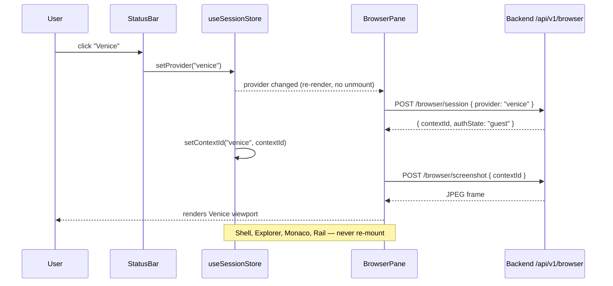

# ACE — UI Architecture

## Pane Grid

```
┌─────────────────────────────────────────────────────────────────────┐
│  body (wallpaper gradient — always visible through 8px gaps)        │
│                                                                     │
│  ┌──────────────┐  ┌──────────────────────────┐  ┌──────────────┐  │
│  │  Explorer    │  │  Monaco Editor           │  │  Context     │  │
│  │  (GlassWin)  │  │  (GlassWindow)           │  │  + Tokens    │  │
│  │              │  │                          │  │  (GlassWin)  │  │
│  │  row-span-2  │  │                          │  │              │  │
│  │              │  ├──────────────────────────┤  │              │  │
│  │              │  │  Browser Pane            │  │              │  │
│  │              │  │  (GlassWindow)           │  │              │  │
│  │              │  │  col-span-2              │  │              │  │
│  └──────────────┘  └──────────────────────────┘  └──────────────┘  │
│                                                                     │
│  ┌─────────────────────────────────────────────────────────────┐   │
│  │  StatusBar  [ACE] [Grok] [Venice] [OpenCode] ● guest  Sync  │   │
│  │                                    Ln 1, Col 1  UTF-8  Live │   │
│  └─────────────────────────────────────────────────────────────┘   │
└─────────────────────────────────────────────────────────────────────┘
```

CSS Grid columns: `14rem  1fr  17rem`  
CSS Grid rows: `1fr  1fr` (when browser pane visible) or `1fr`  
Gap: `8px` (wallpaper shows through)

---

## Provider Switch Flow



---

## Auth State Machine (per provider)

```
         ┌─────────┐
    ───►  │  guest  │ ◄──────────────────────────────┐
         └────┬────┘                                 │
              │ cookies loaded / login detected       │ expireSession()
              ▼                                       │
      ┌───────────────┐                               │
      │ authenticated │ ──── cookie expiry / 401 ─────┘
      └───────────────┘
```

- `guest` — fresh incognito context, no cookies
- `authenticated` — cookies loaded from disk or acquired via in-pane login
- `expired` — degraded back to guest; never crashes the app

---

## New Env Vars

| Variable | Default | Purpose |
|---|---|---|
| `BROWSER_USER_DATA_DIR` | `./data/browser` | Puppeteer persistent profile root |
| `BROWSER_MAX_CONTEXTS` | `20` | Max live incognito contexts before LRU eviction |
| `OPENCODE_BASE_URL` | `http://localhost:3001` | OpenCode agent base URL |

---

## Known Fragile Bits

1. **Grok cookie scraping** — Grok (x.com) aggressively rotates session tokens and
   uses bot-detection. Cookies imported from a real browser session work initially
   but may expire within hours. The auth state machine degrades to `guest`
   gracefully; re-login inside the pane re-acquires cookies automatically.

2. **Screenshot / screencast performance** — The current implementation polls at
   2 fps (500 ms interval) using JPEG screenshots. This is intentionally
   conservative. Upgrade path: switch to CDP `Page.startScreencast` which pushes
   frames via WebSocket at up to 30 fps without polling overhead. The
   `BrowserManager.screenshot()` interface is designed to be swapped out without
   touching the route or the pane component.

3. **Single browser process** — One Puppeteer instance serves all users. If it
   crashes, all contexts are lost and `getBrowserManager()` will re-launch on the
   next request. For production, add a health-check loop that pings the browser
   and restarts proactively.

4. **OpenCode session continuity** — The frontend currently does not persist
   `openCodeSessionId` across page reloads. Add it to `useSessionStore` and
   `localStorage` if conversation history matters.
